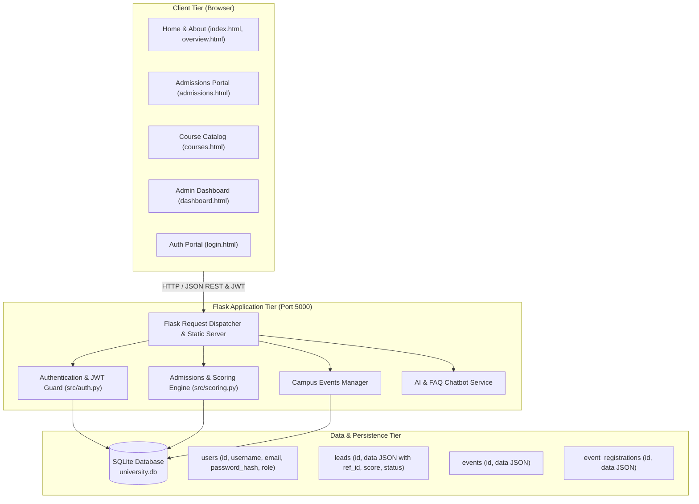
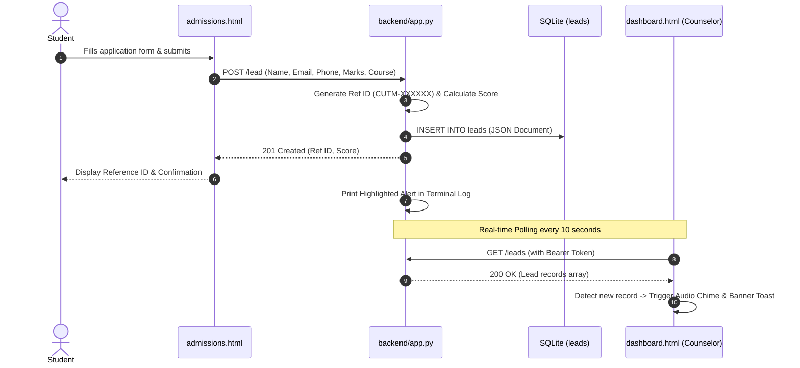

# System Architecture & Technical Specification
## Centurion University of Technology and Management (CUTM)

---

### 1. High-Level Architecture

The CUTM Portal follows a clean, decoupled client-server architecture with modular service layers, lightweight JSON REST APIs, and an embedded SQLite database.



---

### 2. Workspace Directory Structure

```text
AI-enabled website/
│
├── backend/                  # Complete backend application and modular services
│   ├── app.py                # Main Flask application and API route dispatcher
│   ├── config.py             # Configuration constants, course & event catalogs
│   ├── database.py           # SQLite connection manager, schema init & CRUD queries
│   ├── auth.py               # Cryptographic password hashing, JWT signing & guards
│   ├── scoring.py            # AI composite lead scoring & admission prediction
│   ├── ai_service.py         # Institutional FAQ knowledge-base & AI chatbot service
│   ├── models.py             # Domain models (User, Lead, Event, Registration, Course)
│   ├── requirements.txt      # Pinned backend dependencies
│   ├── .env.example          # Sample environment variables
│   ├── README.md             # Comprehensive backend technical documentation
│   └── data/                 # SQLite database storage directory
│       └── university.db     # Active relational database
│
├── frontend/                 # Complete frontend user interface and assets
│   ├── index.html            # Main landing page & hero with panoramic photography
│   ├── admissions.html       # Online application & AI merit/scholarship predictor
│   ├── courses.html          # Multi-faculty filterable program directory (8 branches)
│   ├── dashboard.html        # Counselor console with 10s auto-polling, audio & CSV
│   ├── login.html            # Dual-tab Sign In & New Student Registration portal
│   ├── gallery.html          # Visual tour & campus photography gallery
│   ├── contact.html          # Admissions helpline, campus addresses & Google map
│   ├── overview.html         # University accreditation & about us
│   ├── site.css              # Main institutional design tokens and stylesheet
│   ├── README.md             # Comprehensive frontend documentation
│   ├── css/                  # Mirrored CSS directory
│   ├── js/                   # Shared client utilities & auth helpers
│   └── images/               # Official CUTM circular seal & campus photography
│
├── src/                      # Modular backend architecture
│   ├── __init__.py           # Package initializer
│   ├── config.py             # Environment config, catalog constants, paths
│   ├── database.py           # DB connection helper, seeders, table definitions
│   ├── auth.py               # Password hashing, JWT token lifecycle, role checks
│   ├── scoring.py            # Academic merit evaluation & scholarship algorithm
│   └── app.py                # Flask application factory (create_app)
├── templates/                # Standard Flask HTML templates directory
├── static/                   # Standard Flask static web assets (css, images, js)
├── docs/                     # Comprehensive project documentation
│   ├── PRD.md                # Product Requirements Document
│   ├── ARCHITECTURE.md       # Technical design and architecture
│   ├── DESIGN.md             # UI/UX design specifications
│   ├── RULES.md              # Engineering rules and coding standards
│   ├── TASKS.md              # Project task list and development history
│   ├── MEMORY.md             # Persistent project memory and decisions
│   └── CUTM_Project_Report.docx # University Major Project Report (Word soft copy)
│
├── ml_models/                # Machine learning model training scripts
│   └── train_model.py
│
├── requirements.txt          # Root Python dependencies
├── run.bat                   # Windows one-click startup batch script
└── SETUP.md                  # Installation and developer guide
```

---

### 3. Database Schema (SQLite)

#### Table: `users`
| Column | Type | Constraints | Description |
| :--- | :--- | :--- | :--- |
| `id` | INTEGER | PRIMARY KEY AUTOINCREMENT | Unique user identifier |
| `username` | TEXT | UNIQUE NOT NULL | User handle (3–30 characters) |
| `email` | TEXT | UNIQUE NOT NULL | Verified email address |
| `phone` | TEXT | NULLABLE | 10-digit mobile number |
| `name` | TEXT | NOT NULL | User's full name |
| `password_hash` | TEXT | NOT NULL | Salted hash generated via Werkzeug |
| `role` | TEXT | NOT NULL DEFAULT 'student' | Role (`student` or `admin`) |
| `created_at` | TEXT | NOT NULL | ISO 8601 UTC timestamp |

#### Table: `leads`
| Column | Type | Constraints | Description |
| :--- | :--- | :--- | :--- |
| `id` | INTEGER | PRIMARY KEY AUTOINCREMENT | Unique lead row ID |
| `data` | TEXT | NOT NULL | JSON string: `ref_id`, `name`, `email`, `phone`, `marks`, `department`, `course`, `score`, `city`, `state`, `message`, `status`, `created_at` |

#### Table: `events`
| Column | Type | Constraints | Description |
| :--- | :--- | :--- | :--- |
| `id` | TEXT | PRIMARY KEY | Unique UUID or event slug |
| `data` | TEXT | NOT NULL | JSON string: `title`, `type`, `date`, `place`, `format`, `description`, `image` |

#### Table: `event_registrations`
| Column | Type | Constraints | Description |
| :--- | :--- | :--- | :--- |
| `id` | TEXT | PRIMARY KEY | UUID registration identifier |
| `data` | TEXT | NOT NULL | JSON string: `name`, `email`, `phone`, `event_id`, `event_title`, `created_at` |

#### Table: `app_settings`
| Column | Type | Constraints | Description |
| :--- | :--- | :--- | :--- |
| `key` | TEXT | PRIMARY KEY | Setting name (e.g. `sample_events_seeded`) |
| `value` | TEXT | NOT NULL | Stored flag or string |

---

### 4. API Endpoints Map

| Endpoint | Method | Access | Purpose |
| :--- | :---: | :--- | :--- |
| `/register` | `POST` | Public | Create new student or staff account |
| `/login` | `POST` | Public | Authenticate user & issue JWT bearer token |
| `/api/me` | `GET` | Authenticated | Retrieve current session user payload |
| `/lead` | `POST` | Public | Submit new student admission application |
| `/leads` | `GET` | Admin (JWT) | Retrieve all student applications |
| `/api/application-status/<q>` | `GET` | Public | Look up application status by Ref ID or Phone |
| `/predict` | `POST` | Public | Compute merit probability & scholarship tier |
| `/api/courses` | `GET` | Public | Fetch complete catalog of academic programs |
| `/events` | `GET` | Public | List upcoming conferences and seminars |
| `/events` | `POST` | Admin (JWT) | Publish a new campus event |
| `/events/<id>` | `PUT/DELETE` | Admin (JWT) | Edit or remove an existing campus event |
| `/registrations` | `POST` | Public | Register participant for an event |
| `/registrations` | `GET` | Admin (JWT) | View attendee list for campus events |
| `/chat` | `POST` | Public | Submit query to CUTM AI assistant / FAQ engine |

---

### 5. Data Flow: Admission Intake & Notification



